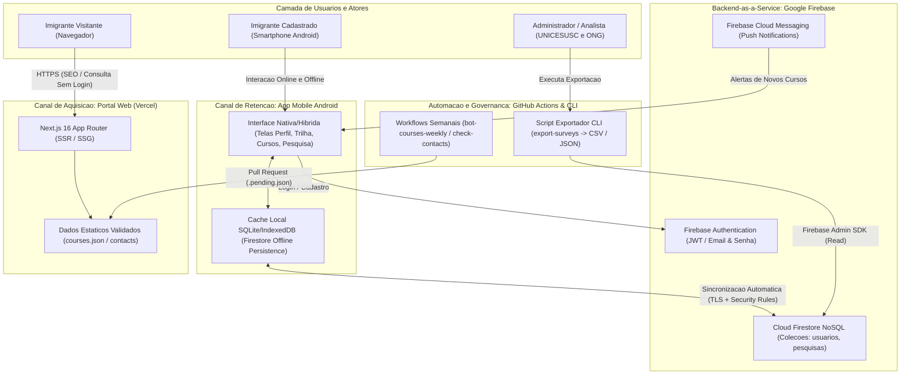
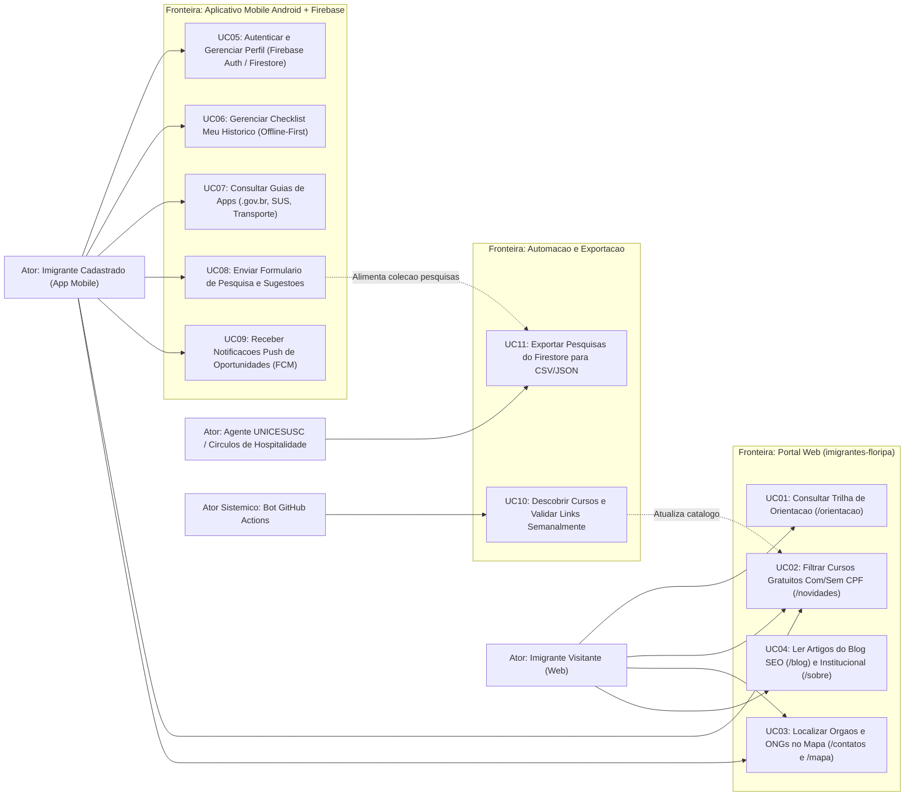
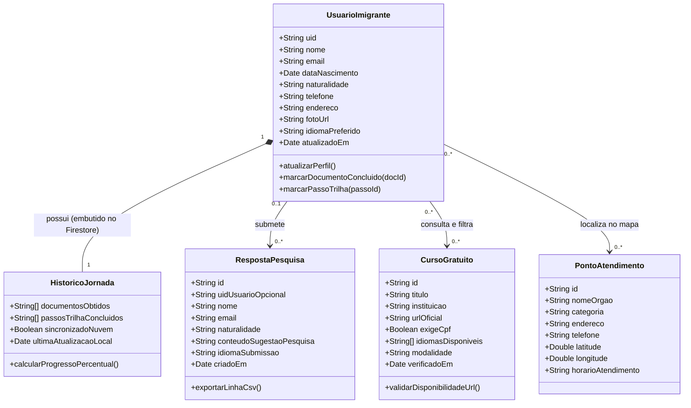
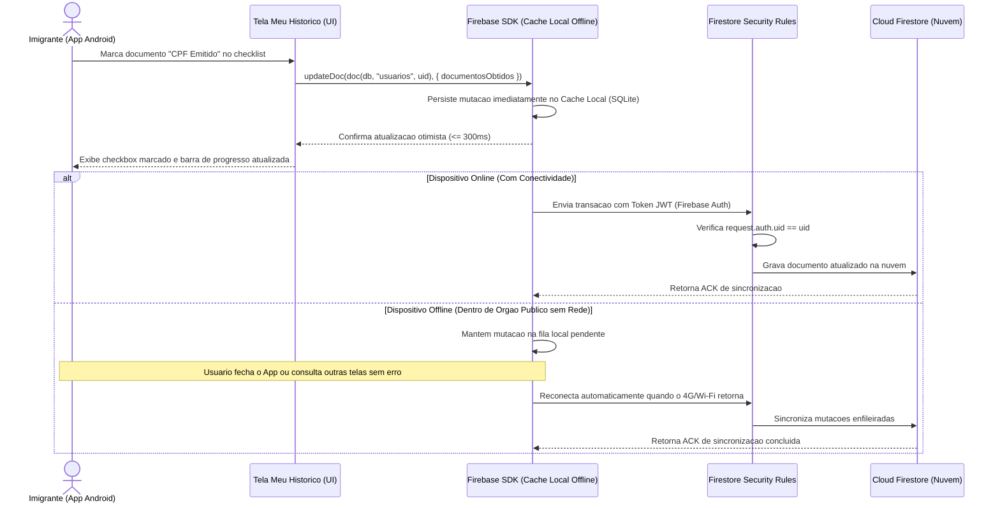

# UNICESUSC — Análise e Desenvolvimento de Sistemas
## Planejamento Ágil Scrum, Arquitetura e Modelagem UML / NoSQL (`PMI III`)

- **Projeto**: Ecossistema Imigrantes Floripa (Portal Web + Aplicativo Mobile Android)
- **Parceria Institucional**: UNICESUSC e Círculos de Hospitalidade
- **Responsável Técnico**: Mateus Carpenter
- **Referências**: [06-revisão-requisitos-e-planejamento-scrum.pdf](file:///home/mateus/imigrantes-floripa/PMI%20III/06-revisão-requisitos-e-planejamento-scrum.pdf) e [Guia_Passo_a_Passo_N2_ADS31.pdf](file:///home/mateus/imigrantes-floripa/PMI%20III/Guia_Passo_a_Passo_N2_ADS31.pdf)

---

## 1. Planejamento Scrum e Governança Ágil

### 1.1. Definition of Done (DoD) — Específica da Stack Tecnológica
Uma User Story do Ecossistema Imigrantes Floripa somente é considerada **Concluída (Done)** quando cumpre integralmente os critérios abaixo:
1. **Qualidade de Código e Tipagem**: Código implementado em TypeScript/Next.js (Web) ou Android/Firebase (Mobile) sem erros de compilação e com aprovação limpa em `npm run lint` (ESLint).
2. **Testes Automatizados e Validação**: Testes unitários e de integração (Vitest) passando com cobertura $\ge 70\%$ nos módulos de negócio e 100% dos cenários Gherkin (cenário feliz e alternativo) verificados.
3. **Conformidade Visual e Acessibilidade**: Interface aderente aos tokens do Design System `HIP-Floripa` (`#6E5594`, `#2A4D9B`, `#C56A3F`, `#1B2440`, `#FBF8F4`), responsiva e com contraste $\ge 4,5:1$ (WCAG 2.1 AA).
4. **Segurança e Persistência**: No escopo Mobile, regras `firestore.rules` validadas garantindo isolamento por `request.auth.uid` e funcionamento *offline-first* testado sem conectividade de rede.
5. **Integração Contínua e Homologação**: Alterações integradas via Pull Request revisada, com Preview Deploy (Vercel) ou build Android funcional e documentação atualizada no dossiê da Sprint.

---

### 1.2. Planejamento da Sprint 1 (Foco: Portal Web Redesign + Fundação Mobile Firebase)

- **Sprint Goal (Objetivo da Sprint 1)**:
  *"Entregar a nova versão do Portal Web (`imigrantes-floripa`) em branch dedicada com o Design System Roxo (`#6E5594`), trilha de orientação vertical indexável pelo Google e vitrine de cursos gratuitos filtrável por exigência de CPF, além de estruturar a autenticação e perfil do usuário no MVP Mobile com Firebase."*
- **Capacidade Planejada**: 21 Story Points (comprometimento de 80% da capacidade produtiva para absorver revisões e testes).

| Story ID | User Story | Pontos | Tarefas Técnicas Decompostas (Sprint Backlog) | Estimativa (h) |
| :--- | :--- | :--- | :--- | :--- |
| **US-004** | Redesign da Home `/portal` e Página Institucional `/sobre` com Design System `#6E5594` | 5 pts | 1. Criar branch de redesign Web e configurar tokens CSS do `HIP-Floripa`.<br>2. Implementar novo Header, Footer e Carrossel de destaque na Home.<br>3. Construir página `/[locale]/sobre` com histórico UNICESUSC + Círculos de Hospitalidade e vídeo da Band. | 10h |
| **US-001** | Trilha de Orientação Vertical Indexável (`/orientacao`) em 4 idiomas | 3 pts | 1. Estruturar layout vertical contínuo SSR em `/[locale]/orientacao`.<br>2. Adicionar marcação estruturada JSON-LD (`HowTo`/`FAQPage`) para SEO.<br>3. Validar traduções (`pt`, `es`, `fr`, `en`) e contraste WCAG AA. | 6h |
| **US-002** | Vitrine de Cursos Gratuitos (`/novidades`) com Filtro Com/Sem CPF | 3 pts | 1. Refatorar listagem de cards de cursos aplicando selos visuais Sem CPF vs. Com CPF (`#C56A3F`).<br>2. Implementar filtros por exigência de CPF, idioma e instituição.<br>3. Escrever testes unitários de filtragem em Vitest. | 6h |
| **US-003** | Diretório de Contatos e Mapa Geolocalizado (`/contatos` e `/mapa`) | 2 pts | 1. Ajustar visualização da lista de contatos e integração com coordenadas do mapa.<br>2. Implementar *fallback* textual resiliente caso o mapa esteja indisponível. | 4h |
| **US-005** | Autenticação Mobile (`Firebase Auth` — Boas-vindas, Login, Cadastro) | 5 pts | 1. Configurar projeto Firebase e integrar SDK `Firebase Authentication` no App Android.<br>2. Implementar telas `Boas-vindas`, `Acesso`, `Cadastre-se` e `Esqueceu a senha?`. | 10h |
| **US-006** | Gestão de Perfil do Imigrante (`Cloud Firestore` + Security Rules) | 3 pts | 1. Implementar tela `Perfil` com edição de Dados Básicos e Dados de Contato.<br>2. Configurar `firestore.rules` garantindo isolamento estrito por `request.auth.uid`. | 6h |

---

### 1.3. Planejamento da Sprint 2 (Foco: Jornada Mobile Offline-First + Pesquisa CSV/JSON + SEO/Push)

- **Sprint Goal (Objetivo da Sprint 2)**:
  *"Concluir o diferencial de retenção do Aplicativo Mobile entregando o checklist documental Meu Histórico com funcionamento Offline-First no Cloud Firestore, os cartões didáticos de aplicativos governamentais, o formulário de pesquisa demográfica com script de exportação CSV/JSON e a rota dedicada de Blog para SEO."*
- **Capacidade Planejada**: 22 Story Points.

| Story ID | User Story | Pontos | Tarefas Técnicas Decompostas (Sprint Backlog) | Estimativa (h) |
| :--- | :--- | :--- | :--- | :--- |
| **US-007** | Checklist Documental e Trilha *Offline-First* (*Meu Histórico* no App) | 8 pts | 1. Habilitar persistência *offline* nativa do `Cloud Firestore` no App.<br>2. Desenvolver interface de marcação de documentos obtidos e etapas da trilha.<br>3. Executar bateria de testes em Modo Avião e sincronização automática. | 14h |
| **US-008** | Cartões Didáticos (`AppCard`) de Aplicativos Essenciais (`.gov.br`, SUS, Transporte) | 3 pts | 1. Implementar componente `AppCard` fiel ao `HIP-Floripa` (`10:3`).<br>2. Popular guias de `.gov.br`, CTPS Digital, Meu INSS, Conecte SUS, Alô Saúde e Floripa no Ponto. | 6h |
| **US-009** | Formulário de Pesquisa no App (`Firestore`) + Script Exportador `CSV`/`JSON` | 3 pts | 1. Implementar tela `Formulário/Pesquisa` gravando na coleção `pesquisas`.<br>2. Criar script Node.js de exportação da coleção `pesquisas` para `CSV` (RFC 4180) e `JSON`. | 6h |
| **US-010** | Rota Dedicada `/[locale]/blog` e Sitemap para Aquisição SEO | 5 pts | 1. Criar estrutura da rota `/[locale]/blog` e template de artigos otimizados por keywords.<br>2. Configurar geração automática de `sitemap.xml` e metadados OpenGraph. | 8h |
| **US-011** | Notificações Push de Novas Oportunidades via `FCM` *(ou Reestruturação `test/`)* | 3–5 pts | 1. Integrar `Firebase Cloud Messaging (FCM)` para recebimento de alertas de novos cursos.<br>2. Consolidar suíte `test/` e relatórios de evidências finais para entrega da N2. | 8h |

---

## 2. Arquitetura do Sistema e Registro de Decisão Técnica (Passo 4 — Guia N2)

### 2.1. Diagrama da Arquitetura Real do Ecossistema



### 2.2. Registro Formal de Decisão Técnica (ADR — Passo 4.2 do Guia N2)

| Item | Registro Técnico do Projeto |
| :--- | :--- |
| **Contexto** | O Aplicativo Mobile precisa autenticar imigrantes, armazenar seu progresso individual na trilha documental (*Meu Histórico*), coletar pesquisas demográficas e funcionar de maneira confiável mesmo quando o imigrante estiver sem conexão à internet dentro de órgãos públicos, mantendo custo zero de hospedagem. |
| **Alternativas Consideradas** | 1. Armazenar dados exclusivamente em `LocalStorage` / dispositivo local sem nuvem (impede recuperação ao trocar de aparelho e inviabiliza o censo centralizado).<br>2. Construir um backend próprio do zero com banco SQL relacional e gerenciar sincronização *offline* manualmente.<br>3. Adotar arquitetura **100% Firebase (`Firebase Auth` + `Cloud Firestore` + `FCM`)** combinada a um script administrativo para exportação do censo em `CSV`/`JSON`. |
| **Escolha Adotada** | **Alternativa 3**: Arquitetura 100% Firebase no Aplicativo Mobile com script exportador `CSV`/`JSON` para análise estatística. |
| **Justificativa** | O `Cloud Firestore` fornece cache *offline-first* nativo e sincronização automática de filas sem necessidade de codificar motores complexos de reconciliação, além de integrar nativamente com `Firebase Authentication` (via *Security Rules* baseadas em `request.auth.uid`) e `FCM` para notificações *push* dentro do plano gratuito (Spark Plan). |
| **Consequência** | Acelera drasticamente a entrega do MVP Mobile e garante resiliência *offline* em campo. Como o Firestore é NoSQL orientado a documentos, a análise tabular dos dados da coleção `pesquisas` pela ONG e pela universidade é resolvida pelo script exportador `CSV`/`JSON` (`RF-012`). |

### 2.3. Especificação das Interfaces de Comunicação (Passo 4.3 do Guia N2)

#### Interface 01: Sincronização de Histórico Documental (`atualizarHistoricoUsuario`)
| Elemento | Descrição Técnica |
| :--- | :--- |
| **Nome da Interface** | Operação de gravação/atualização em `Cloud Firestore`: `doc(db, "usuarios", uid)` |
| **Dados de Entrada** | `uid` (String autenticada do Firebase Auth), `documentosConcluidos` (Array de Strings, ex.: `["cpf", "rnm", "sus"]`), `passosTrilhaConcluidos` (Array de Strings), `updatedAt` (Timestamp). |
| **Validações Realizadas** | 1. No cliente: Verificação de sessão ativa e formato válido dos identificadores.<br>2. No servidor (`firestore.rules`): `request.auth != null && request.auth.uid == uid` e validação de tipos/tamanho do payload. |
| **Resultado de Saída** | Confirmação de escrita no cache local imediata ($\le 300\text{ms}$) e commit assíncrono na coleção `usuarios/{uid}`. |
| **Erros Possíveis** | `PERMISSION_DENIED` (tentativa de escrita sem autenticação ou em UID distinto); `UNAVAILABLE` (tratado de forma transparente pela fila *offline* do Firestore). |

#### Interface 02: Submissão de Pesquisa Demográfica (`enviarFormularioPesquisa`)
| Elemento | Descrição Técnica |
| :--- | :--- |
| **Nome da Interface** | Operação de criação em `Cloud Firestore`: `addDoc(collection(db, "pesquisas"), payload)` |
| **Dados de Entrada** | `nome` (String opcional/identificada), `email` (String), `nacionalidade` (String), `mensagemOuRespostas` (Objeto/String obrigatório), `idioma` (`pt`\|`es`\|`fr`\|`en`), `createdAt` (Timestamp). |
| **Validações Realizadas** | Verificação de preenchimento obrigatório do campo de perguntas/sugestões e formato válido de e-mail antes do envio. |
| **Resultado de Saída** | Identificador único (`docRef.id`) do documento criado na coleção `pesquisas`. |
| **Erros Possíveis** | Mensagem de validação visual na interface caso campos obrigatórios estejam em branco. |

---

## 3. Modelagem UML e Esquema de Dados NoSQL (Item `07` do `to-do.md`)

*(Instrução para o Agente Figma: Estes 3 diagramas UML e o modelo de documentos NoSQL devem ser transpostos para a área de diagramação técnica do projeto no Figma).*

### 3.1. Diagrama de Casos de Uso (Separado por Fronteira de Sistema: Web vs. Mobile)



### 3.2. Diagrama de Classes e Entidades de Domínio



### 3.3. Diagrama de Sequência — Fluxo Central `US-007` (Checklist *Meu Histórico* Offline-First)



---

### 3.4. Especificação do Modelo NoSQL (`Cloud Firestore` — Passo 3 do Guia N2)

#### Coleção 1: `usuarios/{uid}`
- **Chave do Documento**: `uid` gerado pelo `Firebase Authentication`.
- **Regras de Acesso (`firestore.rules`)**: Leitura e escrita permitidas estritamente se `request.auth != null && request.auth.uid == uid`.
- **Estrutura de Documento JSON e Tipos**:
```json
{
  "uid": "f8a9d2c1-4b3e-41a0-9c12-001122334455",
  "dadosBasicos": {
    "nome": "Jean-Baptiste Pierre",
    "nascimento": "1994-05-18",
    "naturalidade": "Haiti",
    "idiomaPreferido": "fr"
  },
  "dadosContato": {
    "telefone": "+5548999990000",
    "email": "jean.pierre@exemplo.com",
    "endereco": "Centro, Florianópolis - SC",
    "fotoUrl": null
  },
  "meuHistorico": {
    "documentosObtidos": ["protocolo_refugio_rnm", "cpf", "cartao_sus"],
    "passosTrilhaConcluidos": ["passo_01_chegada", "passo_02_cpf", "passo_03_sus"],
    "progressoPercentual": 60
  },
  "fcmTokens": ["bk3RNwTe3H0:CI2k_HHwgIpoDKCIZvvDMExUdFQ3P1"],
  "createdAt": "2026-10-15T14:20:00Z",
  "updatedAt": "2026-11-04T14:10:00Z"
}
```

#### Coleção 2: `pesquisas/{pesquisaId}`
- **Chave do Documento**: `Auto-ID` gerado pelo Firestore.
- **Regras de Acesso (`firestore.rules`)**: Permissão `create` para usuários autenticados (com validação de schema e tamanho de texto); permissões `read`, `update` e `delete` bloqueadas para clientes públicos (acessíveis exclusivamente via Firebase Admin SDK pelo script exportador `CSV`/`JSON`).
- **Estrutura de Documento JSON e Tipos**:
```json
{
  "pesquisaId": "psq_20261104_001",
  "uidUsuario": "f8a9d2c1-4b3e-41a0-9c12-001122334455",
  "nome": "Jean-Baptiste Pierre",
  "email": "jean.pierre@exemplo.com",
  "naturalidade": "Haiti",
  "idioma": "fr",
  "dificuldadesPrincipais": ["validacao_diploma", "acesso_govbr", "cursos_sem_cpf"],
  "perguntasSugestoes": "Gostaria de saber onde encontrar aulas presenciais de português no norte da ilha.",
  "createdAt": "2026-11-04T14:15:00Z"
}
```

